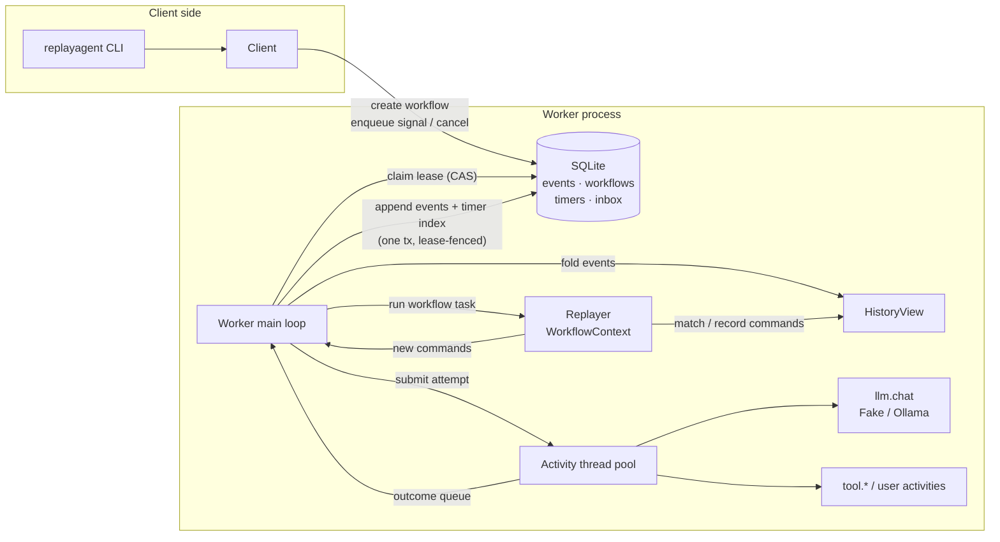

# replayagent

[](https://github.com/lutherleo/replayagent/actions/workflows/ci.yml)

A single-node durable execution runtime for LLM agents, in the style of Temporal.
Workflows are ordinary Python functions. Every LLM call, tool call and other side effect
runs as an *activity* whose result goes into an event-sourced SQLite history. If the
process dies, a new worker replays the workflow function against that history: steps
that already finished return their recorded results without running again, and only
the unfinished work runs.

The package has zero runtime dependencies: it uses only the standard library
(`sqlite3`, `threading`, `urllib`).

## Why

An agent that plans, calls a model a dozen times, calls tools, waits a day for a human
and then publishes something has a lot of places to crash. Restarting from scratch
re-pays for every model call and can repeat side effects. Hand-written checkpointing
gets the "crashed after the effect, before the checkpoint" case wrong.

replayagent gives you the durable-execution model in one dependency-free package you can
read in an afternoon:

- **Event-sourced history** in SQLite (WAL, `synchronous=FULL` by default). Every state
  change is one transaction, fenced by a lease compare-and-set.
- **Deterministic replay** with a determinism checker. The engine compares each
  command the code re-issues with the recorded one (type, activity name, SHA-256 of the
  arguments, timer duration, signal name) and parks the workflow as `blocked` instead
  of corrupting it.
- **Retries with exponential backoff and jitter**, per-attempt timeouts, non-retryable
  errors, and an `at_least_once` / `at_most_once` delivery choice per activity.
- **Durable timers** (`ctx.sleep`) and **human-in-the-loop signals**
  (`ctx.wait_signal(name, timeout=...)`) with exactly-once delivery into history.
- **Versioning guard** (`ctx.get_version`) so in-flight workflows keep replaying after a
  code change, proven against golden histories recorded from an older commit.
- **LLM and tool-calling helpers**: a provider-neutral `llm.chat` activity (fake and
  Ollama providers) and parallel tool-calling loops where every model turn and tool call
  is its own durable step.
- **CLI** to start, run, inspect, export, replay, signal, cancel and resume workflows.
- **Crash injection** at every gap between two transactions, used by the tests and the
  demo to kill real processes mid-workflow.

**Who it is for:** engineers who want durable agents without running a Temporal
cluster, and anyone who wants to see how replay-based durable execution actually works
end to end. It is a learning-grade, single-node runtime, not a Temporal replacement (see
[Limitations](#limitations)).

## Architecture



One worker main thread owns all history writes. A **workflow task** re-runs the workflow
function from the top against the folded history. Recorded commands are matched and
return their recorded outcome; the first command past the end of history is new, so the
function suspends and the worker appends the new commands, starts their activities on
the pool and waits. Recovering after a crash and continuing after an activity finished
are the same code path. Full details: [docs/REPLAY_MODEL.md](docs/REPLAY_MODEL.md)
(user-facing rules) and [docs/ARCHITECTURE.md](docs/ARCHITECTURE.md) (internals,
algorithms, complexity).

| Module | Role |
|---|---|
| `events.py`, `history.py` | event model; incremental fold of a history into state (`HistoryView`) |
| `replay.py` | `WorkflowContext`, command matching, determinism checks, `get_version` |
| `store.py` | SQLite schema, lease-fenced appends, claim/renew/release, timer index, inbox |
| `worker.py` | main loop: outcomes, claim + recover, inbox, timers, workflow tasks |
| `retry.py`, `registry.py` | retry policies; `@workflow` / `@activity`, `App`, activity options |
| `client.py`, `cli.py`, `inspector.py` | start/signal/cancel/resume; CLI; describe, history table, export, offline replay |
| `faults.py` | named crash points (`os._exit` or a raised `BaseException`) |
| `llm/`, `agent.py` | `llm.chat` activity, Fake and Ollama providers; `@tool` schemas, parallel tool loops |
| `examples/research/` | the research agent: BM25 corpus, planner, tool-using researchers, writer, review signal, idempotent publish |

## Quick start

Requires Python 3.12 and [uv](https://docs.astral.sh/uv/).

```bash
uv sync               # dev tools only; the package has no runtime dependencies
make check            # format, lint, mypy --strict, tests + coverage gate
make demo             # offline crash/recover/human-review demo (below)
uv run python examples/quickstart.py
```

A workflow with a parallel fan-out, a human approval, a durable timer and an idempotent
effect (`examples/quickstart.py`, kept in sync with this README by
`tests/test_quickstart.py`):

```python
@activity(retry=RetryPolicy(initial_interval=0.1, maximum_attempts=5))
def fetch_price(sku: str) -> int:
    return {"apple": 3, "pear": 4}[sku]  # any I/O is fine here: it runs once per attempt

@activity
def send_invoice(total: int) -> str:
    key = activity_info().idempotency_key  # stable across retries and crashes
    return f"invoice {key}: {total}"

@workflow
def checkout(ctx: WorkflowContext, order: dict[str, Any]) -> dict[str, Any]:
    prices = ctx.gather(*(ctx.start_activity(fetch_price, sku) for sku in order["items"]))
    if not ctx.wait_signal("approve", timeout=3600):  # human in the loop, durable
        return {"status": "rejected"}
    ctx.sleep(1)  # durable timer: survives restarts
    return {"status": "sent", "receipt": ctx.activity(send_invoice, sum(prices))}
```

```
$ uv run python examples/quickstart.py
{'receipt': 'invoice order-1/4: 7', 'status': 'sent'}
```

The same thing from the CLI (the DB path comes from `--db` or `REPLAYAGENT_DB`):

```bash
replayagent start research --app replayagent.examples.research:create_app --input '{"question": "..."}'
replayagent worker --app replayagent.examples.research:create_app      # runs until stopped
replayagent list
replayagent show <id>                 # status, pending activities/timers/waits, owner
replayagent history <id>              # the event table
replayagent signal <id> review --payload '{"approve": true}'
replayagent replay <id> --app ...     # replay stored history against current code
replayagent export <id> -o h.json && replayagent replay --history h.json --app ...
replayagent cancel <id> | resume <id> | result <id> --wait 30
```

## Demo

`make demo` drives the research agent through the real CLI in subprocesses, with the
deterministic fake model (no network). Two workers are killed by injected crashes: one
in the middle of the parallel research fan-out, one right after the publish step ran but
before its completion was recorded. Output from a real run (trimmed where marked; the
machine name in worker identities is masked by the demo script):

```
=== 2. a worker dies in the middle of the research fan-out ===
$ REPLAYAGENT_CRASH=after_activity_completed@5 replayagent worker --app replayagent.examples.research:create_app --until-idle
  replayagent: injected crash at after_activity_completed
  (exit code 77)
$ replayagent show research-demo
  ...
  status     running
  history    20 events, 7 commands
  owner      <host>/73465/e3eb58ef
  pending
    activity #4 tool.search_corpus: running attempt 1
    activity #5 tool.search_corpus: running attempt 1

=== 3. a new worker resumes from history and parks at the human review ===
$ replayagent worker --app replayagent.examples.research:create_app --until-idle --max-timer-wait 0
  worker done: 5 workflow tasks, 7 activity attempts, 2 recovered, 0 finished, 0 blocked
  ...
  pending
    wait_signal #13 'review': times out in 86399.9s

=== 4. the reviewer asks for a revision ===
$ replayagent signal research-demo review --payload {"approve": false, "feedback": "Add a sentence on at-most-once delivery."}
  queued signal 'review' for research-demo
$ replayagent worker --app replayagent.examples.research:create_app --until-idle --max-timer-wait 0
  worker done: 2 workflow tasks, 1 activity attempts, 0 recovered, 0 finished, 0 blocked

=== 5. approval; the worker dies right after publishing, before recording it ===
$ replayagent signal research-demo review --payload {"approve": true}
  queued signal 'review' for research-demo
$ REPLAYAGENT_CRASH=activity_after_execute@1 replayagent worker --app replayagent.examples.research:create_app --until-idle
  replayagent: injected crash at activity_after_execute
  (exit code 77)
$ replayagent worker --app replayagent.examples.research:create_app --until research-demo
  research-demo completed
  worker done: 2 workflow tasks, 1 activity attempts, 1 recovered, 1 finished, 0 blocked

=== 7. what actually ran ===
  history events: 57   llm.chat commands: 9
  llm.chat attempts recorded: 9   fake model calls made: 9
  publish executions: 2   publications in ledger: 1
  -> 3 worker processes, 2 crashes; finished model calls were never repeated, and
     the publish step ran twice (at-least-once) but its idempotency key kept one row.

=== 8. history (first 14 and last 12 events) ===
   seq        t+s  event                   cmd  details
  ...
    49      0.395  SignalWaitStarted        15  review timeout=86400.0
    50      0.522  SignalReceived            -  review payload={"approve":true}
    51      0.523  SignalConsumed           15  review from event 50 payload={"approve":true}
    52      0.523  ActivityScheduled        16  research.publish args=[{"question":"How do durable execution engines …
    53      0.524  ActivityStarted          16  attempt=1
    54      0.594  ActivityAttemptFailed    16  attempt=1 WorkerLost: worker stopped while at… retry_in=0.000s
    55      0.595  ActivityStarted          16  attempt=2
    56      0.597  ActivityCompleted        16  attempt=2 result={"chars":1614,"path":"research-demo.md"}
    57      0.597  WorkflowCompleted         -  result={"citation_check":{"cited":["idempotency-keys",…

=== 9. replay the stored history against current code ===
$ replayagent replay research-demo --app replayagent.examples.research:create_app
  OK  research-demo (research): replayed 17/17 commands over 57 events, outcome completed

=== 10. a v0 history vs. an unguarded code change (determinism guard) ===
$ replayagent replay --history tests/golden/research_v0.json --app replayagent.examples.research:create_app
  OK  golden-research_v0 (research): replayed 15/15 commands over 47 events, outcome completed
$ replayagent replay --history tests/golden/research_v0.json --app replayagent.examples.research:create_unguarded_app
  DIVERGED  golden-research_v0: non-deterministic workflow 'golden-research_v0' at command #11: command type differs; history has wait_signal 'review' (timeout 86400.0) (event 35) but code issued activity 'research.check_citations' (input 7f0984b624f9d96d)
  (exit code 3: diverged)
```

### The research agent on a real model

`make demo-ollama` runs the same workflow against a local Ollama `llama3.1:8b` (2
sub-questions, review auto-approved). It is optional, needs `ollama serve`, and its
output differs on every run. One real run on the development machine (shared with other
jobs, so the wall time is only indicative):

```
model llama3.1:8b: 70.1s wall, 6 model calls, 1862 prompt + 553 completion tokens
status published, sub-questions: ['What mechanisms do durable execution engines use to track and manage side effects?', 'How do these mechanisms ensure that side effects are not duplicated in case of a crash?']
tool calls per sub-question: [1, 1]
citations: ['idempotency-keys', 'agent-tool-calling', 'sqlite-durability', 'retries-and-backoff']  check: {'cited': ['idempotency-keys', 'agent-tool-calling', 'sqlite-durability', 'retries-and-backoff'], 'unknown': []}
OK  research-ccd9ab948ccb (research): replayed 12/12 commands over 36 events, outcome completed
```

The last line is the point: the real model's recorded responses replay cleanly against
the code with no model calls.

## Testing

`make check` runs `ruff format --check`, `ruff check` (zero warnings), `mypy --strict`
over `src`, `tests`, `scripts` and `examples`, and `pytest` with branch coverage and an
85% gate. Last run: **156 passed, total branch coverage 95.0%** (`make check`; the
coverage table is printed by the `test` target; the figure moves by a few hundredths
between runs because a few worker branches depend on thread timing).

| Suite | What it proves |
|---|---|
| `test_crash_subprocess.py` | A real worker process dies at each of the 8 crash points (multi-hit points at hits 1, 3 and 6: 16 plans) and a fresh process resumes. Checked after every recovery: identical result to an uninterrupted run; each idempotent `charges` row exists exactly once; every activity execution maps to a *recorded* attempt (finished work never re-runs); model calls never exceed recorded `llm.chat` attempts and are not repeated by replay; the history replays cleanly. Plus a SIGKILL soak (random kill times, 2 seeds, up to 40 restarts each) and the honest caveat: a non-idempotent counter *is* bumped twice by a crash at `activity_after_execute`. |
| `test_property.py` | Hypothesis: 150 random programs (activities, parallel fan-outs, flaky activities, sleeps, signals, side effects) under up to 3 random in-process crashes each; results must equal a pure interpreter's, side effects keyed exactly once. |
| `test_determinism.py` | Golden histories recorded by older commits (`research_v0` before the citation check, `research_v1` after) replay against today's code; the unguarded change is detected at command #11; changed results/outcomes are reported. |
| `test_replay.py`, `test_worker.py`, `test_store.py`, `test_units.py` | command matching and every violation type, `get_version` ranges and stale markers, swallowed suspensions, retries/backoff/timeouts/non-retryable errors, at-most-once, timers, signal buffering and timeouts, cancel, lease takeover and fencing, store invariants |
| `test_llm.py`, `test_agent.py`, `test_research.py`, `test_cli.py`, `test_quickstart.py` | providers (Ollama against a local stub HTTP server), tool schemas and loops, the research agent, every CLI command, the README quickstart |

## Benchmarks

`make bench` (`scripts/bench.py`). Numbers are from one run on the development machine
(Apple Silicon laptop, macOS, other jobs running); they are machine-specific.

**Throughput**, 40 workflows x 10 sequential no-op activities, 1 worker:

| synchronous | activities | seconds | activities/s | events/s |
|---|---:|---:|---:|---:|
| FULL | 400 | 0.11 | 3635 | 11632 |
| NORMAL | 400 | 0.07 | 5866 | 18772 |

**Replay cost** vs. history length (one workflow, n sequential activities). Each
workflow task replays from the top, so total replayed commands grow as n(n+1)/2:

| n | events | end-to-end run s | workflow tasks | commands replayed in total | one full replay ms |
|---:|---:|---:|---:|---:|---:|
| 10 | 32 | 0.00 | 11 | 55 | 0.09 |
| 100 | 302 | 0.05 | 101 | 5050 | 0.88 |
| 500 | 1502 | 0.83 | 501 | 125250 | 4.31 |
| 1000 | 3002 | 3.29 | 1001 | 500500 | 8.70 |

**Recovery**, a fresh worker's first tick on an orphaned workflow (claim + load + fold +
replay + schedule the next command): 2.0 ms at 100 completed commands, 19.4 ms at 1,000.

## Design decisions

The full list with costs is in [DECISIONS.md](DECISIONS.md). The ones that shape the API:

- **Replay from the top, no stack snapshots.** Workflow functions are plain synchronous
  Python; suspension is an internal `BaseException`. Simple and debuggable, at the cost of
  O(n) replay per task (see benchmarks).
- **Single writer per workflow, fenced by a lease CAS** on `(history_len, owner)`. External
  writers (signals, cancel) go through an inbox table so they never race the worker.
- **Determinism violations block, they do not fail.** History stays untouched; deploy a
  fix and `replayagent resume`.
- **At-least-once by default, with a stable idempotency key** (`<workflow_id>/<cmd>`). An
  activity interrupted by a crash is retried as a recorded `WorkerLost` attempt that counts
  toward `maximum_attempts`, so a poison activity cannot crash-loop forever.
  `at_most_once` activities instead fail with `ActivityOutcomeUnknown`.
- **No non-blocking `done()`.** `wait_any` returns the handle whose outcome was recorded
  first in history, which is the same on every replay.
- **Retry backoff is computed by the engine and recorded** (`retry_at`), so jitter can be
  random without breaking replay.

## Limitations

- **Single node.** One SQLite file. Several worker processes on one machine can share it
  (leases fence them; a dead local owner is detected by PID), but there is no network
  protocol, no sharding and no cross-host failure detection beyond lease expiry.
- **Replay is O(n) per workflow task, O(n²) per workflow.** Fine for agent-sized
  workflows (a 1,000-step replay is about 9 ms above), but there is no history caching
  across tasks, no sticky execution and no continue-as-new to cap history length.
- **Determinism is checked, not enforced.** Nothing stops workflow code from calling
  `time.time()` or reading a file; the checker catches the consequence only when it
  changes a command's type, name, argument hash, timer duration or signal name. It
  cannot see a non-determinism that changes nothing it compares. Return values are
  compared only by `replayagent replay`.
- **At-least-once means effects can repeat.** Without an idempotency key, a crash
  between an effect and its recorded completion repeats the effect. The tests show this
  on purpose.
- **Activities run on threads in the worker process.** A hung activity that ignores its
  timeout keeps its thread; the timeout fails the attempt in history, but Python cannot
  kill the thread. A crashing native extension takes the worker down (and recovery
  then retries it, bounded by `maximum_attempts`).
- **Cancellation is a hard stop** with no in-workflow cleanup or compensation hook.
- **No child workflows, queries, schedules, search attributes or payload encryption.**
  History payloads are plain JSON in SQLite; do not put secrets in activity arguments.
- **Durability depends on the platform's fsync.** `synchronous=FULL` on macOS does not use
  `F_FULLFSYNC`, so the throughput numbers above are not power-loss-durable numbers.
- **The research agent is a demo.** Its corpus is ten short documents written for this
  repository (see [DATA.md](DATA.md)); the fake model is a scripted responder; the
  real-model run is a single anecdotal sample, not an evaluation of answer quality.

## Roadmap

- History cache per workflow in the worker so tasks replay only new events (sticky
  execution), and continue-as-new to bound history length.
- Child workflows and saga-style compensation helpers.
- Read-only queries against workflow state.
- A Postgres store with `SELECT ... FOR UPDATE SKIP LOCKED` for multi-host workers.
- Activity heartbeats so long LLM calls can report progress and be timed out earlier.

## License

MIT, see [LICENSE](LICENSE).

## Maintainer

Originally developed under the `lutherleo` GitHub account; currently maintained by
**Love Kush Pranu**, Software Developer, with 3+ years of professional experience.

- GitHub: [lutherleo](https://github.com/lutherleo)
- LinkedIn: [lovekush-pranu](https://linkedin.com/in/lovekush-pranu)
- Email: [lp2989@nyu.edu](mailto:lp2989@nyu.edu)