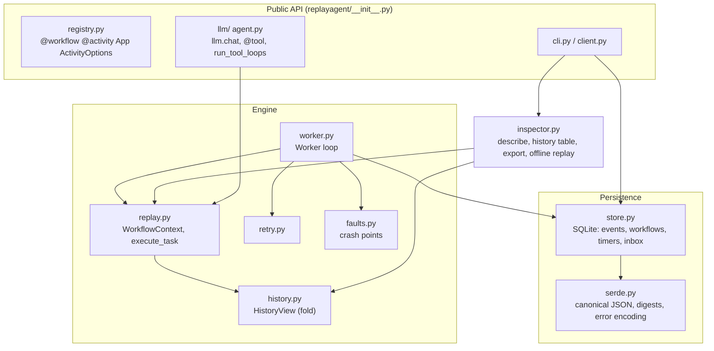

# Architecture

This document covers the internals: data model, the worker loop, the algorithms that make
replay and recovery correct, and their complexity. The user-facing contract (what
workflow code may do, what is guaranteed) is in [REPLAY_MODEL.md](REPLAY_MODEL.md).

## 1. Layers



Dependencies point downwards only. `history.py` and `replay.py` are pure (no I/O), which
is what lets `inspector.replay_history` run a recorded history against code with no
database and no worker.

## 2. Data model

### Events

`Event(seq, type, ts, cmd, data)`; `seq` is 1-based and gap-free per workflow. Command
events carry `cmd`, the 0-based index of the command in the order workflow code issued
it. Resolution events carry the `cmd` they resolve. Bookkeeping events
(`WorkflowStarted`, `SignalReceived`, `CancelRequested`, terminal events) have `cmd=None`.
The event types and their data are listed in REPLAY_MODEL.md section 2.

`ActivityScheduled.data` records the activity name, the canonical-JSON arguments, their
SHA-256 (`input_hash`, compared on replay) and the *fully resolved* options (retry policy,
timeout, delivery). The worker never consults the registry for options of an activity that
is already scheduled, so changing a retry policy in code affects only new schedules.

### SQLite schema (`store.py`)

| Table | Key | Purpose |
|---|---|---|
| `events` | `(workflow_id, seq)`, `WITHOUT ROWID` | append-only history, the source of truth |
| `workflows` | `id` | status, `history_len`, lease `owner` + `lease_until`, result/error, code hash |
| `timers` | `(workflow_id, cmd, kind)`, index on `fire_at` | due-time index: `timer`, `retry`, `activity_timeout`, `signal_timeout` |
| `inbox` | autoincrement `id` | signals and cancellations from outside, consumed by the lease holder |
| `meta` | `key` | schema version |

Everything except `events` is derived or operational. The `timers` table could be
rebuilt from history; it exists so that "what is due now" is an index range scan
instead of a fold over every running workflow.

Connections use WAL mode, `BEGIN IMMEDIATE` transactions, a busy timeout, and
`synchronous=FULL` by default (`NORMAL` is available and used by the property tests for
speed).

## 3. The append: one transaction, lease-fenced

Every state change goes through `Store.append(workflow_id, owner, expected_len, events,
timers=..., status=..., consume_inbox=...)`:

```sql
BEGIN IMMEDIATE;
UPDATE workflows SET history_len = :expected_len + :n, updated_at = :now [, status ...]
 WHERE id = :id AND history_len = :expected_len AND owner = :owner;   -- must hit 1 row
INSERT INTO events ... (seq = expected_len+1 .. expected_len+n);
INSERT OR REPLACE / DELETE FROM timers ...;
DELETE FROM inbox WHERE id = :item AND workflow_id = :id;             -- must hit 1 row
COMMIT;
```

The compare-and-set on `(history_len, owner)` does two jobs: it orders appends (two
writers can never both append event `k`), and it fences a worker that lost its lease
(a paused process that wakes up after another worker took over gets `LeaseLost` and drops
the workflow from memory). Because events, timer index, status and inbox consumption
commit together, no crash can leave, say, a `TimerStarted` without its timer row, or a
signal in history that is still in the inbox.

## 4. The worker loop

`Worker.tick()` runs these steps in order, each step's state changes being one or more
appends as above:

1. **Drain outcomes** from the activity thread pool's queue and record them
   (`ActivityCompleted`, or a failed attempt, see section 6). Stale outcomes (from an
   attempt that already timed out, or a workflow that was cancelled) are ignored by
   checking `(cmd, attempt)` against the fold.
2. **Claim** running workflows that are unowned, whose lease expired, or whose owner is a
   dead process on this host (`owner_is_dead` parses `host/pid/nonce` and probes the PID
   with `kill(pid, 0)`). Each claim is its own CAS on the previous owner. Then
   **recover** each one (section 5).
3. **Inbox**: move signals into history as `SignalReceived` (consuming the inbox row in
   the same transaction) and try to match them to open waits; cancellations append
   `CancelRequested` + `WorkflowCancelled` and close the workflow.
4. **Timers**: fire due rows from the `timers` index for owned workflows.
5. **Workflow tasks** for every workflow whose fold changed ("dirty").

Leases are renewed every `lease_ttl / 3` of wall or clock time. `run_until_idle` loops
ticks until nothing is runnable (optionally advancing past future timers up to
`max_timer_wait`), `run_until_complete` until one workflow leaves `running`, and
`run_forever` until a stop event; the CLI `worker` command wraps these.

## 5. Recovery

A freshly claimed workflow is loaded and folded once (`HistoryView`), then
`Worker._recover` reconciles in-flight work, using only the history:

| State in history | Meaning | Action |
|---|---|---|
| `ActivityScheduled`, no `ActivityStarted` | crashed between appending commands and starting attempts | start attempt 1 |
| `ActivityStarted(attempt k)`, no outcome, `at_least_once` | crashed mid-attempt | record `ActivityAttemptFailed(WorkerLost)` with `retry_at = now` and a `retry` timer row, so attempt k+1 starts on the next tick (subject to `maximum_attempts`) |
| same, `at_most_once` | the effect may or may not have happened | record `ActivityFailed(ActivityOutcomeUnknown, non_retryable)`; the workflow sees an `ActivityError` |
| `ActivityAttemptFailed` with `retry_at` | waiting for backoff | nothing: the `retry` timer row survived in the same transaction |
| `TimerStarted`, no `TimerFired` | durable sleep | nothing: its timer row survived |
| open `SignalWaitStarted` and an unconsumed `SignalReceived` of that name | crashed between the two appends | match them now (`SignalConsumed`) |

Then a workflow task runs. That task replays every recorded command and either
suspends at the same point the dead worker had reached, or (if outcomes were recorded
just before the crash) issues the next commands. There is no separate "recovery
replay": it is the normal task.

**Crash points.** `faults.crashpoint(name)` is called in each gap between two
transactions where a crash would leave state half-way: `after_workflow_claimed`,
`after_commands_appended`, `after_activity_started`, `activity_after_execute` (effect
done, outcome not yet queued), `after_activity_completed`, `after_timer_fired`,
`after_signal_received`, `after_signal_consumed`. A plan `point@n` kills the process on
the n-th hit with `os._exit(77)` (no `finally`, no flush, no commit), or raises
`SimulatedCrash` in-process for the property tests. Each recovery row above is reached by
at least one crash point in `tests/test_crash_subprocess.py`.

## 6. Activities, retries and timeouts

`_start_attempts` appends `ActivityStarted(attempt)` (plus an `activity_timeout` timer row
if the activity has a timeout) *before* submitting to the pool. That ordering is what
makes "started without outcome" mean "maybe ran" during recovery.

The pool thread sets a context variable with `ActivityInfo` (workflow id, cmd, attempt,
deadline, and `idempotency_key = f"{workflow_id}/{cmd}"`, identical for every attempt and
every process), runs the function, round-trips the result through canonical JSON (so a
non-serialisable result fails the attempt instead of the append), and queues the outcome.
Any `BaseException` from the activity becomes a failed outcome; only `SimulatedCrash`
propagates, to emulate the process dying.

A failed attempt is classified by `RetryPolicy.allows_retry(attempt, error)`:
`ApplicationError(non_retryable=True)`, an error type listed in
`non_retryable_error_types`, or exhausted `maximum_attempts` leads to `ActivityFailed`;
otherwise `ActivityAttemptFailed` records `retry_at = now + delay` and a `retry` timer row
is written in the same transaction. The delay is
`min(initial * coeff^(attempt-1), maximum_interval)` scaled by a jitter factor in
`[1-j, 1+j]` drawn from the worker's RNG. Because the engine (not workflow code) computes
it and records the result, randomness is harmless to replay.

An `activity_timeout` row firing while its attempt is still in flight fails that attempt
with `ActivityTimeout` (retryable by policy). The thread cannot be killed; its eventual
outcome is ignored as stale.

## 7. The replayer

`execute_task(defn, view, app, now)` builds a `WorkflowContext` with a cursor at 0 and
calls the workflow function. Each durable call goes through `_issue(type, data)`:

```
skip recorded VersionMarkers the code is not asking for        # see get_version below
if cursor < len(view.commands):
    _match(cursor, view.commands[cursor], type, data)          # raise NonDeterminismError
else:
    append NewCommand(cursor, type, data) to ctx._new
cursor += 1
```

Blocking calls then look up `view.resolutions[cmd]`. A missing resolution raises the
internal `_Suspend` (`BaseException`), which unwinds the function to `execute_task`. The
`TaskResult` is `suspended` (with the new commands), `completed` (with the result,
round-tripped through JSON) or `failed` (with the encoded exception).

Additional checks:

* After the function returns or raises, any recorded commands the code never re-issued
  (`_remaining_history_commands`, ignoring version markers) are a non-determinism.
* If `_Suspend` was swallowed by workflow code (`except BaseException`), the context
  remembers that it suspended; any further durable call re-raises, and a normal return or
  ordinary exception after a swallowed suspension becomes a `WorkflowTaskError`.
* `ctx.random()` is a `random.Random` seeded from the `seed` recorded in
  `WorkflowStarted`; `ctx.uuid4()` draws from it; `ctx.now()` and `ctx.side_effect(fn)`
  record their values as `SideEffectRecorded` and return the recorded value on replay.
* `ctx.logger` drops records while `is_replaying` (cursor still inside recorded commands).

**`get_version(change_id, min, max)`** is the one command that may be *absent* from
history without being a violation. At the cursor: a marker with this `change_id` is
consumed and its version returned; any other recorded command means "this execution
predates the change", so it returns `DEFAULT_VERSION` (-1) *without* advancing the
cursor; past the end of history it records `max`. A version outside `[min, max]` raises
`VersionError`. Conversely, `_skip_stale_markers` lets code that deleted a
`get_version` call replay histories that still contain the marker.

**`wait_any(*handles)`** returns the handle whose resolution has the lowest `seq`
among those already resolved, and suspends if none is. Since `seq` is fixed in history,
the choice is identical on every replay.

### Signal matching

Signals are buffered: `SignalReceived` adds to the fold's mailbox whether or not anyone
is waiting. After any append that could matter (a new signal, a new wait), the worker
matches open waits in command order to the earliest unconsumed signal of the same name
and appends `SignalConsumed(cmd, signal_seq, payload)`. The workflow reads the payload
from that resolution. A `signal_timeout` row fires `SignalWaitTimedOut`, which the
workflow sees as a `SignalTimeout` exception. Matching is done by the worker, not by
workflow code, so replay never depends on when a signal arrived relative to a task.

## 8. Fold (`HistoryView`)

`HistoryView.apply(event)` is an O(1) dispatch per event that validates structure
(`seq` gap-free, nothing after a terminal event, resolutions refer to known commands of
the right type, `cmd` indices dense) and maintains: the command list, `resolutions`
by cmd, per-activity attempt state, timers, signal waits, the mailbox and the terminal
event. The worker keeps one view per owned workflow and applies each appended event to
it, so it never re-reads history from SQLite after the claim. The CLI's `describe` and
the offline replayer use the same fold, so there is exactly one definition of state.

## 9. Complexity

Let *n* be the number of events in a workflow's history and *c* the number of commands.

| Operation | Cost |
|---|---|
| Append k events | O(k) inserts + O(log N) B-tree work each, one fsync (`FULL`) per transaction |
| Claim + load + fold after a crash | O(n) |
| One workflow task | O(c) command matches (dict lookups + comparing a stored 64-hex digest); arguments are hashed once per issued command, O(size of arguments) |
| Whole workflow with c sequential steps | O(c²) replayed commands in total (c(c+1)/2), see `make bench` |
| Due timers | O(log T + due) range scan on `timers_by_fire_at` |
| Inbox delivery | O(items) per tick for owned workflows |
| Memory per owned workflow | O(n) (the fold keeps the events) |

The quadratic total is the main scaling limit. Temporal avoids it with sticky execution
(keeping the coroutine alive between tasks); replayagent's roadmap item is a per-workflow
cache so tasks resume instead of re-running from the top.

## 10. LLM and agent layer

`llm.register_llm(app, provider)` registers one activity, `llm.chat`, whose argument is a
serialised `LLMRequest` (messages, tools, JSON mode, temperature, max tokens) and whose
result is a serialised `LLMResponse` (message, tool calls, finish reason, token usage).
The request is part of the argument hash, so a prompt change in workflow code is detected
as non-determinism for in-flight workflows (guard it with `get_version`). Providers:

* `FakeProvider(responder)`: a deterministic function of the request, with an optional
  JSONL call log that the tests and demo use to count real model calls.
* `OllamaProvider`: `POST /api/chat` with tools, `stream=false`, `urllib` only.
  Connection errors, timeouts, invalid JSON and HTTP 5xx raise `LLMTransientError`
  (retried by the `llm.chat` policy); other HTTP errors are non-retryable
  `ApplicationError`s.

`agent.tool` derives a JSON schema from a function's type hints and docstring;
`register_tools` registers each tool as a `tool.<name>` activity. `run_tool_loops` advances
several conversations in lockstep: one parallel batch of `llm.chat` calls per turn, then
one parallel batch of all requested tool calls, until every conversation answers without
tool calls or hits `max_turns`. Unknown tools and tool errors are returned to the model as
tool messages rather than failing the workflow.

The research example (`examples/research/`) composes these: a JSON-mode planner call, N
parallel researcher loops over a BM25 search tool, a writer call, a `review` signal loop
(revise on feedback, publish on approval, stop unpublished after the default 24 h
review timeout) and an idempotent
publish activity that writes a report file plus a ledger row keyed by the idempotency key.
The citation check added after v0 sits behind `get_version("citation-check", -1, 1)`.
